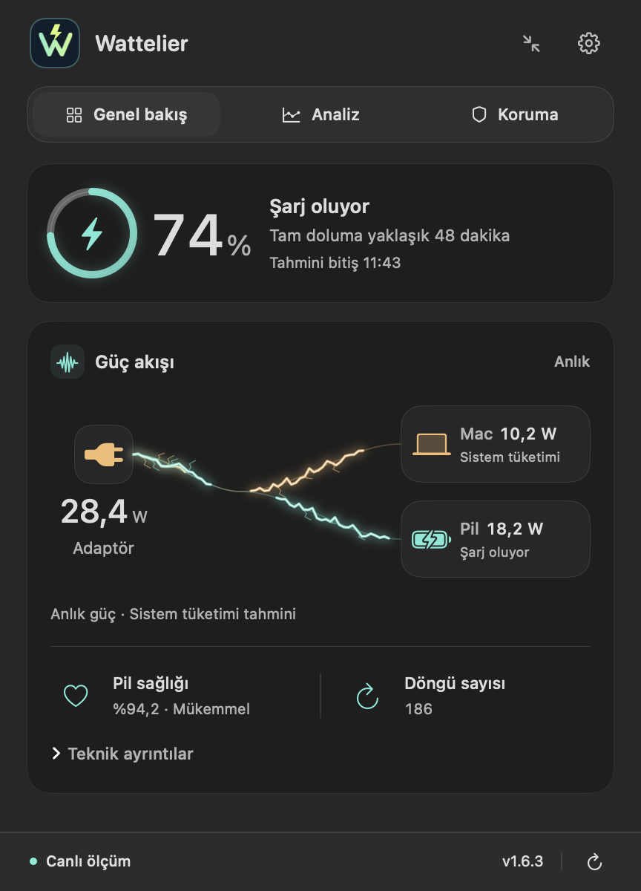
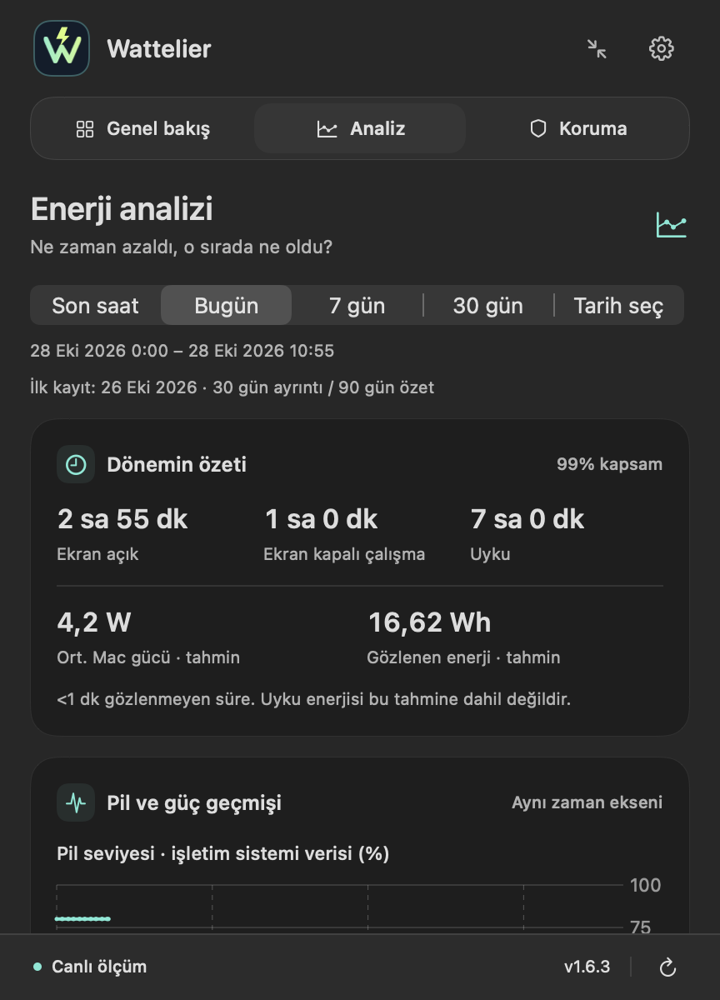
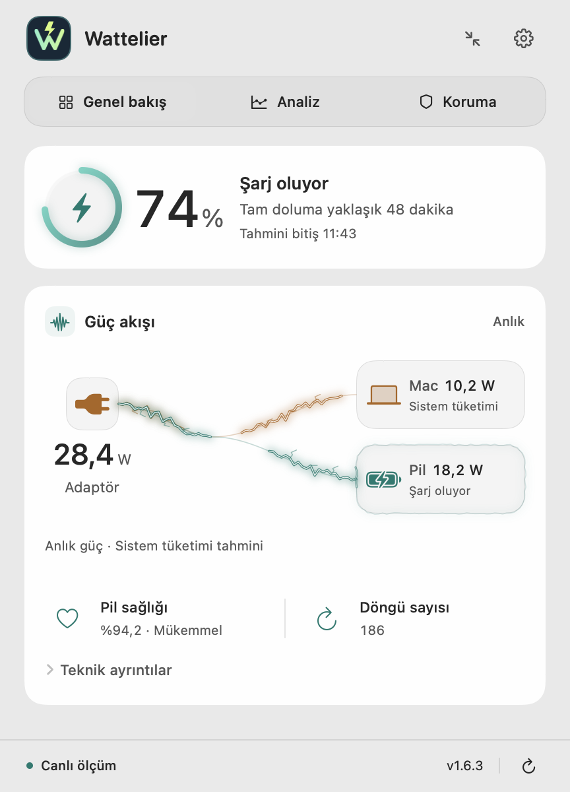
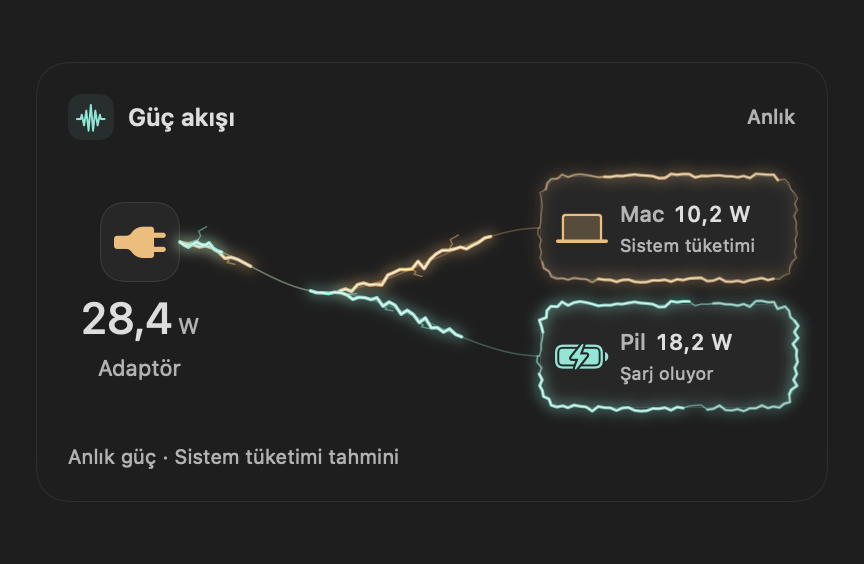

<a href="README.md">Türkçe</a> · <strong>English</strong>

# Wattelier

**Power, clarified. · See beyond the battery percentage.**

Follow your Mac’s battery, power flow and battery changes after sleep from the menu bar.

**[↓ Download Wattelier 1.6.3](https://github.com/Enes-Somuncular/Wattelier-Releases/releases/download/v1.6.3/Wattelier-1.6.3.dmg)** · [Release notes](https://github.com/Enes-Somuncular/Wattelier-Releases/releases/tag/v1.6.3) · [All releases](https://github.com/Enes-Somuncular/Wattelier-Releases/releases)

Apple Silicon · macOS 13+ · Turkish app interface · System / Light / Dark themes

## 1.6.3 — Put your energy history in view

**Persistent analysis, sleep reports and a smaller panel.** The features tried in Beta 5 come together in stable 1.6.3, rebuilt from the same application code.

| Overview · Dark appearance | New energy analysis |
| :---: | :---: |
|  |  |

Images rendered from the 1.6.3 app interface with sample data; these are not personal usage measurements.

### Go back in time, keep the same context

Power history survives app restarts. Explore **30 days of detailed records** and **90 days of hourly summaries**.

Choose **Last hour, Today, 7 days, 30 days or a custom range**. Selecting an interval in the chart updates the summary, sleep sessions, events and app impact together. Battery percentage and estimated Mac power have separate charts; missing periods are not joined with invented measurements.

### What happened while the lid was closed?

Sleep reports show duration, battery levels before and after, and the **net percentage-point difference** when it can be calculated. Available system records add background-wake categories such as maintenance or network access.

Display-off operation and system sleep are tracked separately. The timeline distinguishes **screen on**, **screen off while working**, **sleep** and **unknown periods**. Reports require observed sleep/wake sessions while recording is enabled; old unrecorded gaps are not retroactively labeled sleep.

### A small panel with room to expand

Start with the compact menu-bar panel on first use. Browse **Battery → Power flow → Analysis** using the larger arrow buttons, or Left/Right while the panel has focus.

- Battery level, charge state, health and cycle count share one Battery card.
- Expand or collapse the same panel; your last size is remembered.
- **System, Light and Dark** themes, readable cards and native glass surfaces.
- A classic short battery icon with selectable menu-bar information.

### See power in motion

Amber electricity flows toward your Mac; teal branches toward the charging battery. **Animation speed follows watt values, and arrivals energize the destination frames.** The battery branch stays dim while charging is paused. Electrical animation stops when the panel closes, and macOS **Reduce Motion** is respected.

| Light appearance | Electrical flow |
| :---: | :---: |
|  |  |

## Read the numbers correctly

| Information | What it means |
| --- | --- |
| **Battery level and sleep change** | OS-reported levels and their net percentage-point difference. Not measured Wh or exact per-app consumption. |
| **Mac power and energy** | Model estimates. The last awake watt reading is not carried through sleep gaps. |
| **App impact** | A CPU-based relative estimate. GPU, display and all background activity cannot be attributed precisely. |
| **Screen-on time** | Observed display state, not a measurement of the screen’s standalone watts. |
| **Wake reasons** | Available system events, which may not cover every wake or explain the entire battery loss. |

Missing data is **not zero consumption**. Mixed-power sessions or missing boundary readings are qualified instead of producing a definite drain figure. An unchanged rounded battery percentage does not mean no energy was used.

## Local records, explicit choices

- Detailed battery/analysis and app records stay on this Mac for up to **30 days**; hourly analysis summaries and sleep events for up to **90 days**.
- **App-history recording is off by default.** Enable, stop or delete records when you choose.
- Small appended records and hourly checkpoints avoid rewriting the whole history every minute.
- Battery readings and app lists are not uploaded. Update checks and downloads use GitHub.
- Measurement does not wake the Mac or require administrator access, a privileged helper or power/firmware-setting writes.

## Protection and notifications

Manage charge-target and low-battery reminders in **Koruma**. Full-charge notifications wait for macOS to report completion; opening the app with a full battery does not produce a repeated alert.

**Şarj sınırı ayarlarını aç** opens macOS Battery settings. Use the **lower ⓘ button beside Charging**. Wattelier’s reminder target is not a charging limit; the app does not read or change your system limit. Installing Apple Shortcuts is not required.

## Download, update and start recording

1. Open the **[Wattelier 1.6.3 DMG](https://github.com/Enes-Somuncular/Wattelier-Releases/releases/download/v1.6.3/Wattelier-1.6.3.dmg)** and drag Wattelier into **Applications**.
2. Launch it and click the menu-bar battery.
3. In **Analiz**, leave **Pil ve analiz geçmişini kaydet** enabled. Complete a sleep/wake session to create a sleep report.

**Already installed?** Use **Ayarlar → Güncellemeleri denetle**. Updates from earlier stable versions and **1.6.3-beta.5** to stable 1.6.3 preserve existing preferences and history. Choose **Ayarlar → Güncellemeler → Kararlı** for the stable channel.

[ZIP archive](https://github.com/Enes-Somuncular/Wattelier-Releases/releases/download/v1.6.3/Wattelier-1.6.3.zip) · [SHA256 checksums](https://github.com/Enes-Somuncular/Wattelier-Releases/releases/download/v1.6.3/SHA256SUMS) · [Installation guide](docs/INSTALL.md#english) · [Report an issue](https://github.com/Enes-Somuncular/Wattelier-Releases/issues/new/choose)

**Requirements:** Apple Silicon MacBook and macOS 13 or later. No Intel build. The app is ad-hoc signed; Apple Developer ID signing and notarization are not available yet. See the installation guide for first-launch details.

## Beta channel and existing installations

Choose **Ayarlar → Güncellemeler → Beta** for future previews. Stable 1.6.3 is rebuilt from Beta 5 application code under a stable version identity; existing beta assets remain unchanged in the [release archive](https://github.com/Enes-Somuncular/Wattelier-Releases/releases).

The visible product name is **Wattelier**. The internal **MacBattery.app** path and application identifier are retained to preserve MacBattery preferences, history and Sparkle updates. New downloads use **Wattelier-VERSION.dmg / .zip**.

This repository hosts downloads and product documentation; source code remains private. GitHub’s automatic **Source code (zip/tar.gz)** files are not installers. Use the DMG or application ZIP.

---

[Latest stable release](https://github.com/Enes-Somuncular/Wattelier-Releases/releases/latest) · [FAQ (Türkçe)](docs/FAQ.md) · [Feedback](https://github.com/Enes-Somuncular/Wattelier-Releases/issues/new/choose)

Wattelier · Power, clarified. · Enes Somuncular

